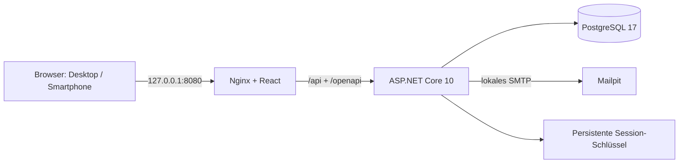
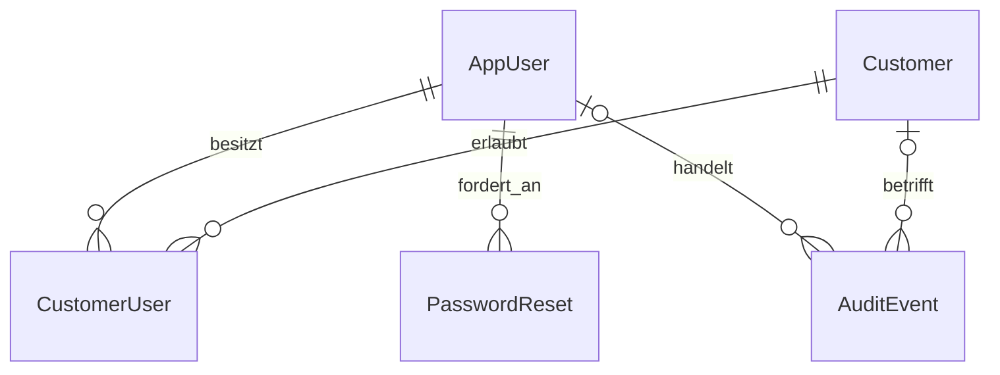

# Architektur und erster Entwicklungsabschnitt

## Ergänzung: tatsächliche Jahresmengen und neutraler Analyseexport v0.7

`MeterAnalytics` lädt freigegebene Messstellen, historische Zuordnungen, Geräteperioden und begrenzte Nachbarablesungen. Jahresmengen verwenden nur vollständig zuordenbare Messintervalle. Die Hierarchiesumme subtrahiert passende Hauptzählerperioden von Unterzählerperioden. Die gleiche Grundlage versorgt Jahreskacheln und Analyseexport. Es ist keine neue Schema-Migration erforderlich.

`AnalysisPrompt` erstellt lokal einen Text über einen autorisierten POST-Endpunkt. Nur kontrollierte Metadaten und neutrale Bezeichnungen werden ausgegeben; Stammdaten und Freitexte gelangen nicht in den Prompt. Zeitanteilige Monatsreihen nutzen die bestehende Intervallrechnung und kennzeichnen Qualität und Lücken. Grenzen: 36 Kalendermonate, 200 Messstellen, 50.000 relevante Ablesungen. Die Erstellung wird auditiert; es gibt keinen ausgehenden KI-Aufruf.

Die Oberfläche zeichnet das gesamte Verbrauchsdiagramm mit ResizeObserver innerhalb der aktuellen Breite und reduziert bei Platzmangel nur die Beschriftungen. Zeitraumkonfiguration und Diagrammwerte sind separat aufklappbar.

## Ergänzung: Katasterlöschung, Maßnahmen und Berichte v0.6

Katasterknoten erhalten `DeletedAt` und einen globalen Queryfilter. Einzelne Löschungen laufen mit Versionsprüfung, Begründung und Audit in einer Transaktion. Kindknoten, historische Zählerzuordnungen, Fahrzeuge und aktive Berichtsvorlagen verhindern die Löschung. Dokumente werden dabei logisch gesperrt; der bestehende Bereinigungsdienst entfernt ihre Blobs.

`MeasureImplemented` und `MeasureNotes` liegen am Verbraucher und nutzen dessen Versionsprüfung. Dokumente mit `Purpose=Measure` sind private PDF-Nachweise; bestehende Dokumente erhalten `Purpose=General`, damit sie nach dem Update sichtbar bleiben. Kopien übernehmen keine Umsetzung oder Maßnahmentexte.

Die Bilanzübersicht berechnet eine Gesamtsumme aus erlaubten Standorten sowie eigenständige Gebäudebilanzen nach derselben bisherigen Rechenmethode. Gesamtansätze verhindern weiterhin Doppelzählung. Die Oberfläche zeigt alle Karten zusammen, voreingestellt als Ring.

`ReportDefinition` speichert mandantenbezogene Filter und Inhalte für spätere PDF-/Excel-Auswertungen. Rolle, Hierarchie, Standortrechte, Datum und Version werden serverseitig geprüft. Die Berichtserstellung selbst gehört noch nicht zu dieser Version.

## Ergänzung: Komponenten, CSV/XLSM und Historienseiten v0.5

`SavingsPercent` wird je Katastereintrag mit 0 vorbelegt. Der Sammel-Endpunkt prüft Rolle, Kunde, Standort, Version und Prozentbereich in einer Transaktion. Kopieren erzeugt neue IDs in einer Transaktion, validiert die Zielhierarchie und entfernt Messstellenverweise; Dateien bleiben am Original. Die fünfte Migration ergänzt ausschließlich die Prozent-Spalte.

Der Messstellendetail-Endpunkt paginiert serverseitig mit 15 Zeilen und optionalen UTC-Datumsgrenzen. Die jeweilige Verbrauchsdifferenz nutzt den berechtigten Vorgänger derselben Geräteperiode unabhängig von Filter und Seite. Nachweise und Revisionen werden nur für die aktuelle Seite geladen.

`MeterCsv` liest UTF-8, UTF-16 und Latin-1 mit Semikolon, Komma oder Tabulator. Signierte CSV-Vorlagen verwenden dieselbe Data-Protection-Bindung wie XLSX. Eigene CSVs benötigen eine explizite Messstellenwahl oder ID-Spalte; der Server prüft Kunde, Standortperiode, Gerät und Einheit. XLSM wird in einer temporären Paketkopie ohne VBA-Teile als Wertetabelle gelesen. Kein VBA wird ausgeführt. Alle Formate durchlaufen denselben Vorschau-/Versionsschutz und die gemeinsame atomare Importprüfung.

## Ergänzung: theoretische Jahresbilanz und XLSX v0.4

`TechnicalNode` erhält eine optionale Jahresmenge sowie Medium/Einheit. `TheoreticalBalance` bildet Gebäude-/Standortbilanzen aus aktiven Teilbäumen. Ein expliziter Gesamtansatz ersetzt gleichartige untergeordnete Ansätze. MWh werden normalisiert; Medien, Volumina und Energierollen bleiben getrennt. Fehlende Werte werden benannt. Die Oberfläche zeigt Kreis-, Ring- oder Balkendiagramme und Datenquellen; Einsparszenarien sind ausdrücklich angenommene Prozentsätze.

`MeterExcel` erzeugt geschützte XLSX-Dateien über ClosedXML 0.105.0. Nur Datums-/Zählerstandszellen sind entsperrt. Eine Data-Protection-Bindung authentifiziert feste Felder, Kunde, Messstelle, Installation und Zeitzone. Die sichtbaren Nummern sind keine Import-Schlüssel. ZIPs werden im Speicher entpackt und begrenzt; Makros in XLSX, externe Verknüpfungen, Formeln, veränderte Vorlagenfelder und fremde Eingabebereiche werden abgewiesen.

Die Importvorschau schreibt keine Ablesungen. Sie prüft alle Kandidaten gegen die gemeinsame zeitliche Reihe aus vorhandenen und neuen Ständen. Ein an Benutzer, Datei-Hashes und Messstellenversionen gebundenes Vorschautoken gilt 30 Minuten. Die Übernahme prüft erneut und speichert alle gültigen Ablesungen in einer serialisierbaren Transaktion. Fehler verhindern den ganzen Stapel; identische Wiederholungen werden übersprungen. Es gibt keine implizite Überschreibung vorhandener Werte. Datei-/Zeilenbezug und Benutzer werden auditiert.

Die automatische Medianregel entfällt vollständig. Ein Tagesverbrauch wird für Warnungen nur bei ausdrücklich konfigurierter Tagesgrenze berechnet. Wertebereich, Reihenfolge, Geräteperiode, Auflösung und explizite Überläufe werden weiterhin geprüft. Benutzer-/Standortrechte gelten auch für XLSX und ZIP.

Die vierte Migration ergänzt die bestehende Datenbank. Eine Kopie des echten 0.3-Prüfbestands wurde auf 0.4 aktualisiert und anhand der alten Inhalte in elf Tabellen geprüft. Details: [Bilanz und Excel](BILANZ-UND-EXCEL.md) sowie [Prüfbericht](PRUEFBERICHT.md).

## Ergänzung: Verwaltung und Verbrauchsreihen v0.3

`WorkspaceEndpoints` ergänzt datenbankgespeichertes globales Branding, ein persönliches Darkmodus-Flag am Benutzer und kunden-/standortgebundene Fahrzeuge. Die Systemadministration darf Logos, Leitspruch und Fahrzeugstammdaten ändern. Logo-PNGs werden geprüft, normalisiert und metadatenfrei als kleine Binärdaten in PostgreSQL gespeichert. Logo und Leitspruch sind für den Login öffentlich lesbar. Mutationen erfordern Sitzung und CSRF; Branding und Fahrzeuge besitzen Versionszähler.

Messstellen erhalten einen Löschzeitpunkt und einen EF-Abfragefilter. Beim Löschen werden offene Zuordnungen/Installationen geschlossen und ein Audit-Eintrag mit Grund geschrieben; Ablesungen bleiben bestehen. Historische Bilanzen lesen gelöschte Unterzähler gezielt mit `IgnoreQueryFilters` nach Kunden- und Standortprüfung. Dokumente werden zuerst logisch unzugänglich gemacht und auditiert; der private Blob wird anschließend entfernt. Ein Hintergrunddienst wiederholt ausstehende Dateibereinigungen.

`ConsumptionEndpoints` lädt nur relevante Ablesungen einschließlich der Nachbarn an den Zeitraumgrenzen. Differenzen werden je Geräteperiode gebildet. Schnittmengen aus Messintervallen, Standortfreigaben, Zuordnungsperioden und Diagrammbalken bestimmen die zeitanteilige Energie. Es gibt keine Extrapolation oder Differenzbildung über Gerätewechsel. UTC-Zeitdauern bewahren die Energie bei Zeitumstellungen; Kalendergrenzen entstehen in der Standortzeitzone. Unbekannte Teile bleiben null und besitzen eine gesonderte Abdeckung/Teilmenge. Direkte Unterzähler werden nur während ihrer tatsächlichen Unterordnung bilanziert; Enkel werden nicht doppelt addiert.

Die Oberfläche trennt Hardwarekataster und Zählerpflege. Drag-and-drop öffnet das bestehende historisierte Zuordnungsformular; dieselben serverseitigen Regeln gelten für Formular und Drag-and-drop. SVG-Balken mit Textinformationen und ergänzender Wertetabelle benötigen keine externen Grafikdienste. Kopfzeile und Kundenauswahl sind dauerhaft beim Scrollen sichtbar.

Die neue Migration ergänzt vorhandene Installationen. Ein Upgrade von einer echten 0.2-Demodatenbank wurde mit Prüfsummen aller alten Daten in neun Tabellen geprüft. Weitere Module wie Tank-/Ladevorgänge, Berichte und PDCA bleiben spätere Ausbaustufen.

## Ergänzung: technisches Kataster und Zählerverwaltung v0.2

Der modulare Monolith wurde um `TechnicalEndpoints`, `MeterEndpoints`, `MeterService`, `DocumentEndpoints` und das erweiterte Dashboard ergänzt. Der Arbeitsablauf ist in [KATASTER.md](KATASTER.md) dokumentiert.

`TechnicalNode` bildet einen typisierten relationalen Anlagenbaum aus Standort, Gebäude, Bereich/Anlage, Verteilung, Verbrauchergruppe und Einzelverbraucher. Fachliche Stammdaten liegen in eigenen Spalten, zusätzliche Textfelder in JSONB. Zusammengesetzte Fremdschlüssel verhindern kundenübergreifende Eltern-/Messstellenverknüpfungen. Versionszähler schützen parallele Bearbeitungen. Verbraucherberechnungen bleiben explizite Schätzungen.

`MeasuringPoint` ist die dauerhafte Messstelle, `MeterDevice` das physische Gerät. `MeterInstallation` enthält dessen zeitliche Installation mit Faktor, Auflösung und Überlaufparametern. `MeterAssignment` historisiert Anlagenknoten, Standort und Hauptmessstelle. Partielle eindeutige Indizes erlauben nur eine offene Zuordnung/Installation pro Messstelle und eine offene Installation pro Gerät. Hierarchieänderungen prüfen Zyklen, Medium, Einheit und Messrichtung. Standortwechsel liegen nach vorhandenen Ablesungen; Anlagenknoten werden nicht rückwirkend verschoben.

`MeterReading` trennt Ablese- und Speicherzeitpunkt und speichert Dezimalwerte. `ReadingRevision` erhält frühere Zustände bei Korrekturen; `MeterReplacement` verknüpft alte und neue Geräteperioden. Fehlende Austauschablesungen werden aus den gespeicherten Perioden abgeleitet und als unvollständig angezeigt. Messstellenmutationen verwenden serialisierbare Transaktionen und Versionszähler. Verbrauch wird innerhalb einer Geräteperiode ermittelt. Die Bilanz verlangt exakte Randablesungen und passende Zuordnungen/Einheiten, zählt direkte Unterzähler einmal und interpoliert fehlende Werte nicht stillschweigend.

`SiteScope` und `SitePermission` ergänzen Kundenzuordnungen. Eine Beschränkung erlaubt ausgewählte Standorte oder mit leerer Auswahl keinen Standort. API, Historie und Dateizugriffe prüfen erlaubte Standortperioden. Eingeschränkte Kundenadministratoren vererben ihre Rechte und dürfen Benutzer mit weitergehenden Standortrechten nicht ändern.

`StoredDocument` verknüpft private Dateien mit Katasterknoten oder Ablesungen. `IPrivateFileStore` trennt Anwendung und Speicher. Der Blob-Adapter verwendet lokal Azurite und später bei entsprechender Konfiguration Azure Blob Storage. JPEG/PNG werden mit Magick.NET normalisiert und von Metadaten bereinigt; PDFs als Download ausgeliefert. Die neue Migration ergänzt vorhandene Daten. Technische Demodaten entstehen ausschließlich bei einer neuen Demo-Installation.

Die folgenden Abschnitte beschreiben die Phase-1-Grundlage. Der aktuelle Prüfstand steht in [PRUEFBERICHT.md](PRUEFBERICHT.md). Fuhrpark-Verbrauchserfassung, Berichtswesen, PDCA und kaufmännische Module bleiben weitere Ausbaustufen.

## Technische Entscheidungen

Modularer Monolith, mit getrennten HTTP-Modulen für Authentifizierung, Kunden und Benutzer. React 19/TypeScript und TanStack Query bilden das Frontend; Vite erstellt statische Assets. Nginx liefert die Anwendung und leitet API-Anfragen unter derselben Origin an ASP.NET Core 10 weiter. EF Core 10 und Npgsql speichern relationale Daten in PostgreSQL 17. Es werden gesperrte Paketversionen verwendet. Mailpit fängt lokale Reset-E-Mails ab.

Für die spätere Azure-Bereitstellung werden Konfiguration und Verbindungen über Laufzeitvariablen zugeführt. Container, relationale Datenbank und fachliche Berechtigungen bleiben nutzbar. Lokale Passwörter und Mailpit werden später durch individuelle Aktivierung und einen geeigneten Authentifizierungs-/Versanddienst ersetzt. Diese Version ist nicht für eine Veröffentlichung im Internet freigegeben.

## Implementiertes Datenmodell

- `AppUser`: UUID, normalisierte eindeutige E-Mail, Name, Passwort-Hash, fachliche Rolle, Aktivstatus, Pflichtpasswortwechsel, Sperrzeit, Fehlversuche, Sitzungsverarbeitung und Zeitstempel.
- `Customer`: UUID, eindeutige Kundennummer, Firmendaten, Kontakt, Anschriften, USt-ID, Vertragsbeginn, Aktivstatus, interne Notizen, Freigabe der Kunden-Benutzerverwaltung und Versionszähler.
- `CustomerUser`: zusammengesetzter Primärschlüssel aus Kunden- und Benutzer-ID mit echten Fremdschlüsseln. Systemadministratoren können mehrere Zuordnungen besitzen. Sie erhalten keine automatische Lesefreigabe für unzugeordnete Kunden.
- `PasswordReset`: Benutzer-Fremdschlüssel, SHA256-Hash eines zufälligen 256-Bit-Tokens, Ablaufzeit und Verwendungsstatus. Der eigentliche Token wird nicht in der Datenbank gespeichert.
- `AuditEvent`: Akteur, optionaler Benutzer-/Kunden-Fremdschlüssel, Aktion, Zeitpunkt in UTC, Ergebnis, Ziel, Details und Korrelations-ID. Änderungen enthalten fachliche Vorher-/Nachher-Daten; Passwörter und Reset-Tokens werden nicht protokolliert.

Die initiale EF-Migration liegt versioniert in `backend/Migrations`. Bei Start werden ausstehende Migrationen angewendet. In dieser lokalen Version startet nur eine API-Instanz; parallele produktive Rollouts benötigen später einen gesonderten Migrationsschritt. Seed-Daten werden ausschließlich in Development mit `App__SeedDemo=true` und leerer Benutzertabelle angelegt. Ein erneuter Start überschreibt keine vorhandenen Daten.

Optimistische Nebenläufigkeit verhindert, dass ein veraltetes Kundenformular neuere Änderungen überschreibt. Benutzeränderungen prüfen eine Versionskennung und verwenden eine serialisierbare Transaktion. Ein Passwort-Reset ist ebenfalls transaktional und einmalig.

## Rollen und Berechtigungen

Authentifizierung beantwortet, welcher Benutzer angemeldet ist. Die fachliche Rolle und explizite Kundenzuordnung bestimmen seine Rechte.

| Aktion | Systemadministrator | Kundenadministrator | Kundenbenutzer | Kundenleser |
| --- | --- | --- | --- | --- |
| Eigene Kontodaten und Passwort | Ja | Ja | Ja | Ja |
| Freigegebene aktive Kundendaten lesen | Ja | Ja | Ja | Ja |
| Interne Kundennotizen lesen | Ja | Nein | Nein | Nein |
| Kunden anlegen / ändern / deaktivieren | Ja | Nein | Nein | Nein |
| Inaktive zugeordnete Kunden sehen | Ja | Nein | Nein | Nein |
| Benutzer verwalten | Für freigegebene Kunden | Nur nach Kundenfreigabe; nur Kundenbenutzer/Leser | Nein | Nein |
| System-/Kundenadministratoren ernennen | Ja | Nein | Nein | Nein |
| Audit-Protokoll lesen | Ja | Nein | Nein | Nein |

Benutzeränderungen benötigen Zugriff auf sämtliche vorhandenen Kundenzuordnungen des Benutzers. Ein Kundenadministrator darf keinen mandantenübergreifenden Benutzer oder anderen Administrator bearbeiten. Eigene Deaktivierung oder eigene Rollenänderung sind über die Verwaltung gesperrt; mindestens ein aktiver Systemadministrator muss erhalten bleiben.

Mandantentrennung wird durch serverseitig eingeschränkte Abfragen und geprüfte Fremdschlüsselzuordnungen durchgesetzt. PostgreSQL Row-Level Security ist in dieser Phase nicht implementiert. In SQL besteht referenzielle Integrität; Abfragen dürfen nur über die mandantenbeschränkten API-Pfade laufen. Eine spätere Datenbank-RLS-Schicht kann als zusätzliche Absicherung ergänzt werden.

Cookie-Sitzungen sind HttpOnly, SameSite=Strict, acht Stunden gültig und ohne unbegrenzte Verlängerung. Jede authentifizierte Anfrage prüft Aktivstatus und Sitzungskennung gegen die Datenbank. Passwortänderung, Reset, Rechteänderung und Abmeldung widerrufen vorherige Sitzungen. CSRF-Tokens sind für schreibende API-Anfragen einschließlich Anmeldung erforderlich. Nach fünf falschen Kennwörtern wird ein Konto für 15 Minuten gesperrt. Zusätzlich sind Authentifizierungsanfragen begrenzt. Ohne vorgeschaltete IP-Vertrauenskonfiguration gilt diese Begrenzung im Compose-Betrieb gemeinsam für die über Nginx laufenden Anfragen; die Kontosperre ist unabhängig davon benutzerspezifisch.

Passwörter verwendet der ASP.NET-Core-Identity-PasswordHasher mit PBKDF2 und 210.000 Iterationen. Daten und Audit-Änderungen werden gemeinsam gespeichert. Das lokale Datenvolume und die Data-Protection-Schlüssel sind noch nicht anwendungsseitig verschlüsselt; lokale Dateisystem- und Docker-Rechte sind entsprechend zu behandeln.

## Bildschirmstruktur und Design

Administration: Übersicht → Kundenverzeichnis/Kundenakte → Benutzer/Rollen/Kundenzuordnungen → Aktivitäten → Mein Konto. Kundenportal: Übersicht → Mein Unternehmen → ggf. freigegebene Benutzerverwaltung → Mein Konto. Der Kundenbereich enthält nur tatsächlich verfügbare Funktionen.

Zentrale Tokens: Dunkelgrau `#34383D`, Grau `#737A81`, Orange `#F28C28`, Hintergrund `#F5F6F7`, Weiß. Systemschrift ohne externe Font-Dienste, Abstände überwiegend 8/12/16/24 px, kleine Radien, ruhige Tabellen und sichtbare Fokusrahmen. Orange Schaltflächen haben dunkle Schrift. Formulare besitzen echte Beschriftungen; Dialoge verwenden das native HTML-Dialogelement mit Fokusführung und Escape-Unterstützung. Das austauschbare Beispiel-Logo dient als Schalter für die Sidebar.

## Geplanter Ausbau

| Phase | Lieferumfang und notwendige Datenstrukturen |
| --- | --- |
| 1 – umgesetzt | Authentifizierung, Kunden, Benutzer, Berechtigungen, Audit, responsive Grundoberfläche, echte PostgreSQL-Persistenz |
| 2 | Standort → Gebäude → Bereiche; Messstelle getrennt von Gerät und zeitlicher Installation; Ablesungen, Revisionen, Plausibilität, Zählertausch, Dateispeicheradapter und Azurite |
| 3 | Anlagen/Verteilungen, Verbrauchergruppen, Verbraucher mit technischen Spezifikationen, geschätzter Energiebedarf, Fahrzeuge und Tank-/Ladeeinträge |
| 4 | Gerätespezifische Verbrauchsintervalle, versionierte Zählerhierarchien, Bilanzen ohne Doppelzählung, Tarife und Preisperioden, Versorgerrechnungen, ECharts, PDF/Excel und persistente Erinnerungsaufträge |
| 5 | PDCA-Maßnahmen mit Berechnung, Umsetzung und Wirksamkeitsvergleich; Angebote, Aufträge, Rechnungen und Dokumentversionen |
| 6 | Validierte Importaufträge und 15-Minuten-Zeitreihen, Qualitätskennzeichen, kontrollierte KI-Vorschläge ohne Überschreiben von Originalmesswerten |

Künftige Mess- und Kostenwerte erhalten exakte Dezimaltypen, UTC-Zeitstempel, Standortzeitzonen und getrennte Kennzeichnung für Messung, Berechnung und Schätzung. Zählertausch erfordert abgeschlossene Geräteperioden; Alt- und Neuzählerstände werden niemals direkt voneinander abgezogen. Diese fachlichen Funktionen sind in Phase 1 noch nicht implementiert und daher noch nicht als Energieanalyse validiert.

Vor Produktivbetrieb offen: Entra-/Einladungskonzept, HTTPS und sichere Proxy-Vertrauenskonfiguration, Secret Store, E-Mail-Verifikation, MFA, sichere Dateiablage, Lösch-/Aufbewahrungsprozesse, kontrollierte Backups und Restore-Proben, Datenschutz-/Sicherheitsprüfung sowie Lasttests. Keine rechtliche oder technische Zertifizierung wird für diese lokale Grundanwendung behauptet.
